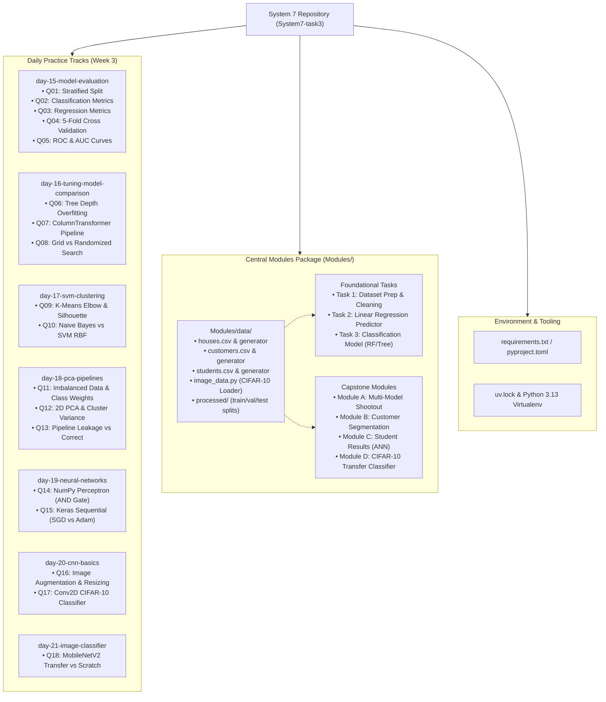
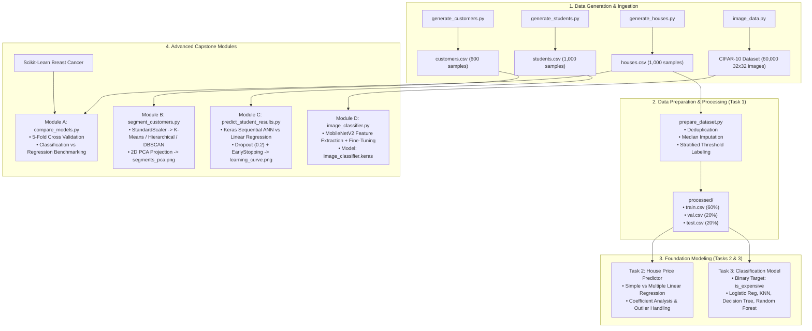
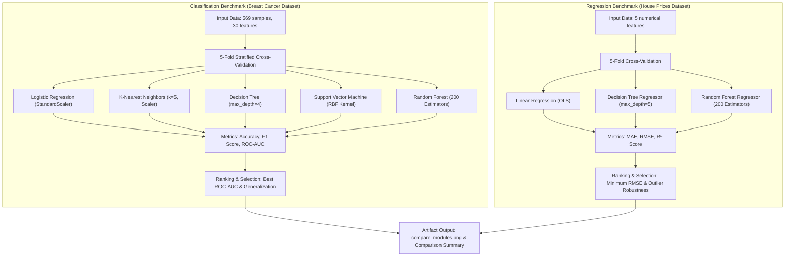
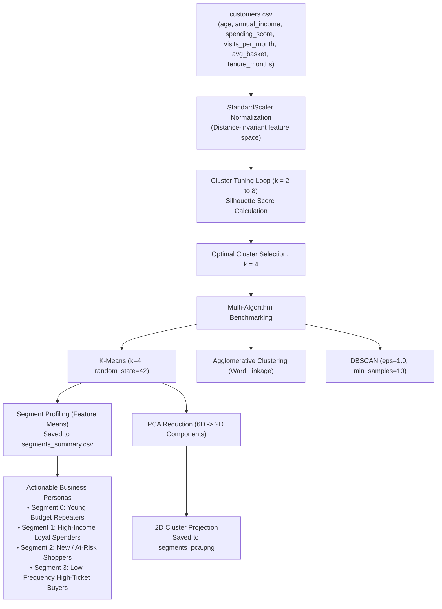
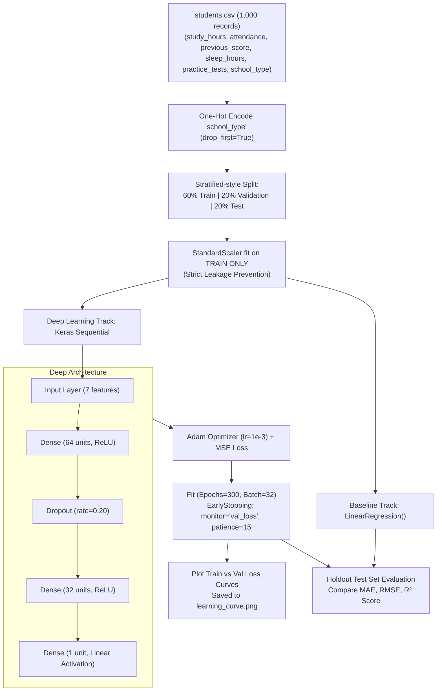
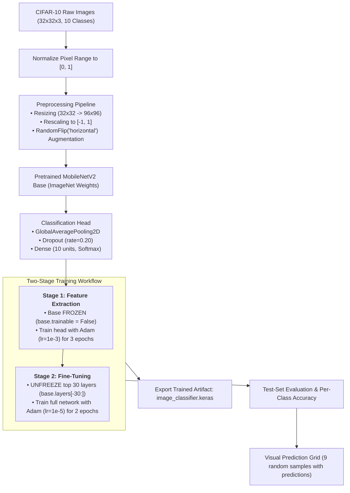

# System 7 Repository — Machine Learning & Deep Learning Curriculum

Mentor: **Saad Hassan Saadi**  
Program: **System 7 · Beginner to Intermediate**  
Curriculum Scope: **Week 2 (Mathematics & ML Basics)** and **Week 3 (Model Evaluation, Advanced ML & Deep Learning)**  

---

## Table of Contents

- [Overview](#overview)
- [System Architecture & Repository Map](#system-architecture--repository-map)
- [Learning Roadmap & Progressive Flow](#learning-roadmap--progressive-flow)
- [Machine Learning Pipelines & Workflow Diagrams](#machine-learning-pipelines--workflow-diagrams)
  - [1. End-to-End Data Lifecycle & Practical Tasks Flow](#1-end-to-end-data-lifecycle--practical-tasks-flow)
  - [2. Module A: Multi-Model Benchmark & Cross-Validation](#2-module-a-multi-model-benchmark--cross-validation)
  - [3. Module B: Customer Segmentation & PCA 2D Clustering](#3-module-b-customer-segmentation--pca-2d-clustering)
  - [4. Module C: Deep Neural Network vs Baseline Regression](#4-module-c-deep-neural-network-vs-baseline-regression)
  - [5. Module D: Two-Stage Transfer Learning Image Classifier](#5-module-d-two-stage-transfer-learning-image-classifier)
  - [6. Data Leakage Prevention Architecture (Day 18 Q13)](#6-data-leakage-prevention-architecture-day-18-q13)
- [Repository Folder Structure](#repository-folder-structure)
- [Curriculum Schedule](#curriculum-schedule)
  - [Week 2 – Mathematics & Machine Learning Basics](#week-2--mathematics--machine-learning-basics)
  - [Week 3 – Model Evaluation, Advanced ML & Deep Learning](#week-3--model-evaluation-advanced-ml--deep-learning)
- [Week 3 Practice Questions Matrix (Q01 – Q18)](#week-3-practice-questions-matrix-q01--q18)
- [Applied Tasks & Modules Specification](#applied-tasks--modules-specification)
  - [Week 2 Practical Tasks (Tasks 1–3)](#week-2-practical-tasks-tasks-13)
  - [Week 3 Capstone Modules (Modules A–D)](#week-3-capstone-modules-modules-ad)
- [Shared Datasets & Generators](#shared-datasets--generators)
- [Environment Setup & Execution Guide](#environment-setup--execution-guide)
- [Daily Progress & Deliverables Log](#daily-progress--deliverables-log)

---

## Overview

This repository represents the hands-on implementation of the **System 7** Machine Learning and Deep Learning engineering curriculum. It covers statistical modeling, classical machine learning algorithms, cross-validation best practices, unsupervised clustering, dimensionality reduction, artificial neural networks with TensorFlow/Keras, and transfer learning for computer vision.

The codebase is organized into two primary pillars:
1. **Daily Practice Tracks (`day-15-*` through `day-21-*`)**: Daily bite-sized question implementations (Q01 to Q18) accompanied by execution logs, verified terminal output screenshots (`Run_file/` / `Running file/`), and diagnostic plots (`figures/`).
2. **Applied Capstone Modules (`Modules/`)**: Production-style workflows including synthetic dataset generation, end-to-end pipelines, multi-model evaluation benchmarks, customer clustering, tabular deep regression, and transfer learning on image classification.

---

## System Architecture & Repository Map



---

## Learning Roadmap & Progressive Flow

The curriculum follows a structured learning progression where each day builds directly on the theoretical foundations and implementation techniques of preceding days:

```mermaid
flowchart LR
    D15["Day 15<br/><b>Model Evaluation</b><br/>• Metrics (F1, ROC)<br/>• Stratified Splits<br/>• Cross-Validation"]
    --> D16["Day 16<br/><b>Hyperparameter Tuning</b><br/>• Overfitting Control<br/>• ColumnTransformer<br/>• Grid & Random Search"]
    --> D17["Day 17<br/><b>SVM & Clustering</b><br/>• Kernel SVM<br/>• Naive Bayes<br/>• K-Means & Silhouette"]
    --> D18["Day 18<br/><b>PCA & Pipelines</b><br/>• Dimensionality Reduction<br/>• Class Imbalance<br/>• Leakage Prevention"]
    --> D19["Day 19<br/><b>Neural Networks</b><br/>• Perceptron Logic<br/>• Backprop & Optimizers<br/>• Keras Tabular ANN"]
    --> D20["Day 20<br/><b>CNN Basics</b><br/>• Conv2D & Pooling<br/>• Image Augmentation<br/>• CIFAR-10 CNN"]
    --> D21["Day 21<br/><b>Transfer Learning</b><br/>• Frozen Pretrained Base<br/>• Fine-Tuning<br/>• MobileNetV2"]
```



---

## Machine Learning Pipelines & Workflow Diagrams

### 1. End-to-End Data Lifecycle & Practical Tasks Flow



---

### 2. Module A: Multi-Model Benchmark & Cross-Validation

Module A evaluates multiple algorithms under identical 5-fold cross-validation setups across classification and regression domains to select and justify best-in-class models.



---

### 3. Module B: Customer Segmentation & PCA 2D Clustering

Module B executes an unsupervised clustering pipeline on customer behavioral data, applying feature scaling, silhouette optimization, multi-algorithm comparison, and PCA dimensionality reduction.



---

### 4. Module C: Deep Neural Network vs Baseline Regression

Module C benchmarks a deep feed-forward neural network against an Ordinary Least Squares (OLS) baseline for predicting continuous student exam scores from study habits.



---

### 5. Module D: Two-Stage Transfer Learning Image Classifier

Module D trains a high-accuracy multiclass image classifier on CIFAR-10 by leveraging transfer learning from a pretrained MobileNetV2 architecture.



---

### 6. Data Leakage Prevention Architecture (Day 18 Q13)

A core engineering principle emphasized in Day 18 (Q13) is isolating all preprocessing transformations within Scikit-Learn `Pipeline` constructs to eliminate data leakage.

```mermaid
flowchart TD
    subgraph LeakyPipeline["Flawed Workflow (Data Leakage)"]
        FullData["Full Dataset (Train + Test Combined)"] --> LeakyScale["Fit Scaler & Feature Selector on ALL Data"]
        LeakyScale --> Sneak["Information from future test set sneaks into training!"]
        Sneak --> LeakySplit["Train / Test Split"]
        LeakySplit --> LeakyModel["Fit Model"]
        LeakyModel --> LeakyScore["Over-optimistic / Unrealistic High Scores"]
    end

    subgraph CorrectPipeline["Production Workflow (Pipeline Guard)"]
        RawData["Raw Dataset"] --> HonestSplit["Train / Test Split FIRST"]
        HonestSplit --> TrainSet["Training Set Only"]
        HonestSplit --> TestSet["Test Set (Strictly Held Out)"]
        TrainSet --> PipeFit["Pipeline.fit(X_train)<br/>• Scaler computes μ & σ from Train ONLY<br/>• Selector selects features from Train ONLY<br/>• Estimator learns weights from Train ONLY"]
        PipeFit --> PipeTransform["Pipeline.predict(X_test)<br/>• Transforms Test using saved Train parameters"]
        TestSet --> PipeTransform
        PipeTransform --> HonestScore["Reliable, Production-Generalizable Metrics"]
    end
```



---

## Repository Folder Structure

```
System7-task3/
├── README.md                                   # Master repository documentation (this file)
├── pyproject.toml                              # Project configuration & dependencies (Python >=3.13)
├── requirements.txt                            # Core dependencies list (NumPy, Pandas, Scikit-learn, TF)
├── uv.lock                                     # Pinned dependency lockfile
├── .gitignore                                  # Git exclusion configuration
├── .python-version                             # Python version pin (3.13)
│
├── day-15-model-evaluation/                    # Week 3, Day 1: Evaluation Metrics & Cross-Validation
│   ├── figures/                                # Generated analytical figures
│   │   └── q05_roc_curves.png                  # Multi-model ROC comparison curves
│   ├── practice/                               # Daily practice question scripts
│   │   ├── q01_split_stratify.py               # Stratified train-test splitting
│   │   ├── q02_classification_metrics.py       # Precision, recall, F1 & confusion matrix
│   │   ├── q03_regression_metrics.py           # MAE, MSE, RMSE, R² NumPy vs Sklearn
│   │   ├── q04_cross_validation.py             # 5-fold cross-validation mean & std
│   │   └── q05_roc_curves.py                   # ROC curve & AUC calculation
│   └── Run_file/                               # Verified terminal execution screenshots
│       ├── q01.png                             # Execution proof for Q01
│       ├── q02.png                             # Execution proof for Q02
│       ├── q03.png                             # Execution proof for Q03
│       ├── q04.png                             # Execution proof for Q04
│       └── q05.png                             # Execution proof for Q05
│
├── day-16-tuning-model-comparison/             # Week 3, Day 2: Tuning, ColumnTransformers & Pipelines
│   ├── README.md                               # Day 16 overview & learning notes
│   ├── figures/
│   │   └── q06_depth_vs_score.png              # Decision tree depth overfitting curve
│   ├── practice/
│   │   ├── q06_tree_depth_overfitting.py       # Tree depth 1 to 15 train vs test score
│   │   ├── q07_column_transformer.py           # ColumnTransformer numeric scaling & OHE
│   │   └── q08_svm_tuning.py                   # GridSearchCV vs RandomizedSearchCV SVM
│   └── Run_file/
│       ├── q06.png                             # Execution proof for Q06
│       ├── Q07.png                             # Execution proof for Q07
│       └── Q08.png                             # Execution proof for Q08
│
├── day-17-svm-clustering/                      # Week 3, Day 3: SVM, Naive Bayes & Clustering
│   ├── README.md                               # Day 17 overview & learning notes
│   ├── figures/
│   │   └── q09_choose_k.png                    # K-Means Elbow curve & Silhouette plot
│   ├── practice/
│   │   ├── q09_kmeans_choose_k.py              # K-Means k=2..10 elbow & silhouette
│   │   └── q10_naive_bayes_vs_svm.py           # Naive Bayes vs SVM precision/recall
│   └── Running file/
│       ├── q09.png                             # Execution proof for Q09
│       └── q10.png                             # Execution proof for Q10
│
├── day-18-pca-pipelines/                       # Week 3, Day 4: PCA, Imbalanced Data & Pipelines
│   ├── README.md                               # Day 18 overview & learning notes
│   ├── figures/
│   │   └── q12_pca_clusters.png                # 2D PCA cluster projection plot
│   ├── practice/
│   │   ├── q11_imbalanced_class_weight.py      # class_weight='balanced' recall boost
│   │   ├── q12_pca_2d.py                       # PCA 2-component projection & variance
│   │   └── q13_pipeline_leakage.py             # Leaky vs Honest pipeline demonstration
│   └── Running file/
│       ├── q11.png                             # Execution proof for Q11
│       ├── q12.png                             # Execution proof for Q12
│       └── q13.png                             # Execution proof for Q13
│
├── day-19-neural-networks/                     # Week 3, Day 5: Deep Learning Foundations & Keras
│   ├── README.md                               # Day 19 overview & learning notes
│   ├── figures/
│   │   └── q15_sgd_vs_adam.png                 # Loss curves comparing SGD vs Adam
│   └── practice/
│       ├── q14_perceptron_and.py               # Pure NumPy perceptron learning AND gate
│       └── q15_keras_sgd_vs_adam.py            # Keras Sequential model loss comparison
│
├── day-20-cnn-basics/                          # Week 3, Day 6: Computer Vision & CNN Architecture
│   ├── README.md                               # Day 20 overview & learning notes
│   └── practice/
│       ├── q16_resize_augment.py               # Keras resizing, normalization & augmentation
│       └── q17_cnn_cifar10.py                  # Conv2D + MaxPooling CNN on CIFAR-10
│
├── day-21-image-classifier/                    # Week 3, Day 7: Transfer Learning with Pretrained CNNs
│   ├── README.md                               # Day 21 overview & learning notes
│   └── practice/
│       └── q18_transfer_vs_scratch.py          # MobileNetV2 transfer vs CNN from scratch
│
└── Modules/                                    # Central Applied Tasks & Shared Data Framework
    ├── data/                                   # Shared datasets and generation utilities
    │   ├── customers.csv                       # Customer dataset for segmentation (600 rows)
    │   ├── houses.csv                          # House prices dataset (500 rows)
    │   ├── students.csv                        # Student academic performance dataset (1,000 rows)
    │   ├── generate_customers.py               # Generator script for customer personas
    │   ├── generate_houses.py                  # Generator script for house properties
    │   ├── generate_students.py                # Generator script for student records
    │   ├── image_data.py                       # CIFAR-10 dataset downloader & helper
    │   └── processed/                          # Processed splits generated by Task 1
    │       ├── train.csv                       # 60% training partition
    │       ├── val.csv                         # 20% validation partition
    │       └── test.csv                        # 20% untouched test partition
    │
    ├── task1_dataset_preparation/              # Week 2 Task 1: Dataset Exploration & Cleaning
    │   ├── README.md                           # Task 1 documentation & requirements
    │   └── prepare_dataset.py                  # Cleaning, median imputation & split script
    │
    ├── task2_house_price_predictor/            # Week 2 Task 2: Linear & Multiple Regression
    │   ├── README.md                           # Task 2 documentation & deliverables
    │   └── house_price_predictor.py            # Regression pipeline & coefficient analysis
    │
    ├── task3_classification_model/             # Week 2 Task 3: Binary Classification
    │   ├── README.md                           # Task 3 documentation & deliverables
    │   └── classification_model.py             # Classifying houses as expensive/inexpensive
    │
    ├── moduleA_model_comparison/               # Week 3 Module A: Cross-Validation Benchmarking
    │   ├── README.md                           # Module A specification
    │   ├── compare_models.py                   # 5-fold CV shootout across classifiers & regressors
    │   └── compare_modules.png                 # Benchmark summary visualization
    │
    ├── moduleB_customer_segmentation/          # Week 3 Module B: Unsupervised Clustering & PCA
    │   ├── README.md                           # Module B specification
    │   ├── segment_customers.py                # Clustering, silhouette tuning & PCA pipeline
    │   ├── segments_pca.png                    # 2D PCA cluster visualization
    │   └── segments_summary.csv                # Tabular profiling of discovered segments
    │
    ├── moduleC_student_results/                # Week 3 Module C: Tabular Neural Network Regression
    │   ├── README.md                           # Module C specification
    │   ├── predict_student_results.py          # Keras Sequential vs Linear Regression
    │   └── learning_curve.png                  # Training & validation loss curves
    │
    └── moduleD_image_classifier/               # Week 3 Module D: Vision Transfer Learning
        ├── README.md                           # Module D specification
        └── image_classifier.py                 # MobileNetV2 two-stage transfer learning pipeline
```

---

## Curriculum Schedule

### Week 2 – Mathematics & Machine Learning Basics

| Day | Topics | Folder Name |
| :--- | :--- | :--- |
| **Day 1** | What is AI, ML and Deep Learning; supervised, unsupervised, reinforcement learning; dataset terms | `day-08-ml-foundations` |
| **Day 2** | Descriptive Statistics: Mean, median, mode, variance, standard deviation | `day-09-descriptive-statistics` |
| **Day 3** | Linear Algebra: Vectors, matrices, dot products, matrix multiplication | `day-10-linear-algebra` |
| **Day 4** | Probability, correlation, train/validation/test split; dataset exploration | `day-11-probability-data-prep` |
| **Day 5** | Linear and multiple linear regression; classification vs regression; Scikit-learn workflow | `day-12-regression-sklearn` |
| **Day 6** | Classification: Logistic regression, KNN, decision trees, random forests | `day-13-classification-models` |
| **Day 7** | Model interpretation: Predictions, coefficients, feature importance | `day-14-house-price-classifier` |

### Week 3 – Model Evaluation, Advanced ML & Deep Learning

| Day | Module | Topics | Folder Name |
| :--- | :---: | :--- | :--- |
| **Day 1** | **A** | Train-test split, cross-validation, classification & regression metrics, confusion matrix, ROC-AUC | [`day-15-model-evaluation`](day-15-model-evaluation/) |
| **Day 2** | **A** | Overfitting/underfitting, scaling, encoding, GridSearchCV, RandomizedSearchCV; model comparison | [`day-16-tuning-model-comparison`](day-16-tuning-model-comparison/) |
| **Day 3** | **B** | Support Vector Machines (SVM), Naive Bayes, K-Means, hierarchical clustering, DBSCAN | [`day-17-svm-clustering`](day-17-svm-clustering/) |
| **Day 4** | **B** | PCA, feature engineering, imbalanced datasets, data leakage, pipelines; segmentation | [`day-18-pca-pipelines`](day-18-pca-pipelines/) |
| **Day 5** | **C** | Perceptrons, backpropagation, gradient descent, optimizers (SGD vs Adam), Keras workflow | [`day-19-neural-networks`](day-19-neural-networks/) |
| **Day 6** | **D** | Image preprocessing, data augmentation, convolution, pooling, CNN architecture on CIFAR-10 | [`day-20-cnn-basics`](day-20-cnn-basics/) |
| **Day 7** | **D** | Multiclass classification, transfer learning (feature extraction vs fine-tuning), evaluation | [`day-21-image-classifier`](day-21-image-classifier/) |

---

## Week 3 Practice Questions Matrix (Q01 – Q18)

All 18 practical questions are implemented in their corresponding day directories. Execution screenshots demonstrating working runs and verified outputs are maintained in each day's execution folder (`Run_file/` or `Running file/`).

| # | Difficulty | Day | Script Path | Core Objective & Methodology | Execution Record / Output Plot |
| :---: | :---: | :---: | :--- | :--- | :--- |
| **01** | Easy | 15 | [`q01_split_stratify.py`](day-15-model-evaluation/practice/q01_split_stratify.py) | Stratified 80/20 split preserving class balance on Breast Cancer | [`Run_file/q01.png`](day-15-model-evaluation/Run_file/q01.png) |
| **02** | Easy | 15 | [`q02_classification_metrics.py`](day-15-model-evaluation/practice/q02_classification_metrics.py) | Accuracy, precision, recall, F1, and confusion matrix display | [`Run_file/q02.png`](day-15-model-evaluation/Run_file/q02.png) |
| **03** | Easy | 15 | [`q03_regression_metrics.py`](day-15-model-evaluation/practice/q03_regression_metrics.py) | Manual NumPy formulas for MAE, MSE, RMSE, R² validated against Sklearn | [`Run_file/q03.png`](day-15-model-evaluation/Run_file/q03.png) |
| **04** | Medium | 15 | [`q04_cross_validation.py`](day-15-model-evaluation/practice/q04_cross_validation.py) | 5-fold cross-validation computing mean & std for LR, DT, and RF | [`Run_file/q04.png`](day-15-model-evaluation/Run_file/q04.png) |
| **05** | Medium | 15 | [`q05_roc_curves.py`](day-15-model-evaluation/practice/q05_roc_curves.py) | Multi-classifier ROC curve plotting & AUC metric evaluation | [`Run_file/q05.png`](day-15-model-evaluation/Run_file/q05.png) · [`Plot`](day-15-model-evaluation/figures/q05_roc_curves.png) |
| **06** | Medium | 16 | [`q06_tree_depth_overfitting.py`](day-16-tuning-model-comparison/practice/q06_tree_depth_overfitting.py) | Decision tree depth sweeps (1 to 15) illustrating bias–variance tradeoff | [`Run_file/q06.png`](day-16-tuning-model-comparison/Run_file/q06.png) · [`Plot`](day-16-tuning-model-comparison/figures/q06_depth_vs_score.png) |
| **07** | Medium | 16 | [`q07_column_transformer.py`](day-16-tuning-model-comparison/practice/q07_column_transformer.py) | `ColumnTransformer` pipeline: StandardScaler for numeric + OneHot for categorical | [`Run_file/Q07.png`](day-16-tuning-model-comparison/Run_file/Q07.png) |
| **08** | Medium | 16 | [`q08_svm_tuning.py`](day-16-tuning-model-comparison/practice/q08_svm_tuning.py) | `GridSearchCV` vs `RandomizedSearchCV` hyperparameter tuning speed & accuracy | [`Run_file/Q08.png`](day-16-tuning-model-comparison/Run_file/Q08.png) |
| **09** | Medium | 17 | [`q09_kmeans_choose_k.py`](day-17-svm-clustering/practice/q09_kmeans_choose_k.py) | K-Means clustering across k=2..10 with elbow inertia and silhouette curve | [`Running file/q09.png`](day-17-svm-clustering/Running%20file/q09.png) · [`Plot`](day-17-svm-clustering/figures/q09_choose_k.png) |
| **10** | Medium | 17 | [`q10_naive_bayes_vs_svm.py`](day-17-svm-clustering/practice/q10_naive_bayes_vs_svm.py) | Gaussian Naive Bayes vs RBF Support Vector Machine precision and recall | [`Running file/q10.png`](day-17-svm-clustering/Running%20file/q10.png) |
| **11** | Medium | 18 | [`q11_imbalanced_class_weight.py`](day-18-pca-pipelines/practice/q11_imbalanced_class_weight.py) | Synthetic imbalanced dataset (95:5) handling via `class_weight='balanced'` | [`Running file/q11.png`](day-18-pca-pipelines/Running%20file/q11.png) |
| **12** | Hard | 18 | [`q12_pca_2d.py`](day-18-pca-pipelines/practice/q12_pca_2d.py) | 2D Principal Component Analysis dimensionality reduction & cluster projection | [`Running file/q12.png`](day-18-pca-pipelines/Running%20file/q12.png) · [`Plot`](day-18-pca-pipelines/figures/q12_pca_clusters.png) |
| **13** | Hard | 18 | [`q13_pipeline_leakage.py`](day-18-pca-pipelines/practice/q13_pipeline_leakage.py) | Demonstrating data leakage on real data & random noise vs `Pipeline` fix | [`Running file/q13.png`](day-18-pca-pipelines/Running%20file/q13.png) |
| **14** | Easy | 19 | [`q14_perceptron_and.py`](day-19-neural-networks/practice/q14_perceptron_and.py) | Single-layer Rosenblatt perceptron implemented from scratch in NumPy | Output logged in console |
| **15** | Medium | 19 | [`q15_keras_sgd_vs_adam.py`](day-19-neural-networks/practice/q15_keras_sgd_vs_adam.py) | Sequential Keras network comparing convergence of SGD vs Adam optimizers | [`Plot`](day-19-neural-networks/figures/q15_sgd_vs_adam.png) |
| **16** | Medium | 20 | [`q16_resize_augment.py`](day-20-cnn-basics/practice/q16_resize_augment.py) | Keras image preprocessing pipeline: resizing, rescaling, random flips & zooms | Output generated |
| **17** | Hard | 20 | [`q17_cnn_cifar10.py`](day-20-cnn-basics/practice/q17_cnn_cifar10.py) | Deep Conv2D + MaxPooling2D + Dropout CNN trained on CIFAR-10 dataset | Confusion matrix output |
| **18** | Hard | 21 | [`q18_transfer_vs_scratch.py`](day-21-image-classifier/practice/q18_transfer_vs_scratch.py) | MobileNetV2 pretrained feature extractor vs convolutional network from scratch | Model evaluation output |

---

## Applied Tasks & Modules Specification

### Week 2 Practical Tasks (Tasks 1–3)

#### Task 1: Dataset Exploration & Preparation
- **Location:** [`Modules/task1_dataset_preparation/prepare_dataset.py`](Modules/task1_dataset_preparation/prepare_dataset.py)
- **Objective:** Ingest raw house property data, execute descriptive statistics, impute missing values using median statistics, eliminate duplicates, and construct a stratified binary label `is_expensive` without information leakage.
- **Outputs:** Verified partitions in `Modules/data/processed/` (`train.csv`, `val.csv`, `test.csv`).

#### Task 2: House-Price Predictor (Regression)
- **Location:** [`Modules/task2_house_price_predictor/house_price_predictor.py`](Modules/task2_house_price_predictor/house_price_predictor.py)
- **Objective:** Fit simple linear regression (single feature: `area_sqft`) and multiple linear regression (5 features: `area_sqft`, `bedrooms`, `bathrooms`, `age_years`, `distance_km`) using Scikit-Learn pipelines.
- **Evaluation:** Evaluated on validation and held-out test partitions via MAE, RMSE, and $R^2$. Provides direct econometric interpretation of regression coefficients.

#### Task 3: Basic Classification Model
- **Location:** [`Modules/task3_classification_model/classification_model.py`](Modules/task3_classification_model/classification_model.py)
- **Objective:** Classify properties as expensive or not expensive using Logistic Regression, KNN ($k=5$), Decision Trees, and Random Forests.
- **Evaluation:** Precision, recall, F1-score, test-set confusion matrix, and Gini feature importances.

---

### Week 3 Capstone Modules (Modules A–D)

#### Module A: Model Comparison & Justification
- **Location:** [`Modules/moduleA_model_comparison/compare_models.py`](Modules/moduleA_model_comparison/compare_models.py)
- **Task:** Perform rigorous 5-fold cross-validation comparisons across multiple model families for classification and regression tasks.
- **Models Benchmarked:**
  - *Classification:* Logistic Regression, KNN, Decision Tree, Support Vector Machine (RBF), and Random Forest.
  - *Regression:* Linear Regression, Decision Tree Regressor, and Random Forest Regressor.
- **Artifact:** [`Modules/moduleA_model_comparison/compare_modules.png`](Modules/moduleA_model_comparison/compare_modules.png)

#### Module B: Customer Segmentation with Clustering & PCA
- **Location:** [`Modules/moduleB_customer_segmentation/segment_customers.py`](Modules/moduleB_customer_segmentation/segment_customers.py)
- **Task:** Discover distinct customer personas from behavioral metrics (income, spending habits, transaction volume, tenure).
- **Pipeline:** Features scaled with `StandardScaler` $\rightarrow$ Silhouette score optimization identifies optimal clusters ($k=4$) $\rightarrow$ Multi-algorithm verification with Agglomerative Hierarchical Clustering and DBSCAN $\rightarrow$ 2D PCA projection.
- **Artifacts:**
  - Visual cluster map: [`Modules/moduleB_customer_segmentation/segments_pca.png`](Modules/moduleB_customer_segmentation/segments_pca.png)
  - Persona summary table: [`Modules/moduleB_customer_segmentation/segments_summary.csv`](Modules/moduleB_customer_segmentation/segments_summary.csv)

#### Module C: Student Results Prediction using Deep Neural Networks
- **Location:** [`Modules/moduleC_student_results/predict_student_results.py`](Modules/moduleC_student_results/predict_student_results.py)
- **Task:** Predict continuous final exam scores (0–100) from academic metrics and study habits.
- **Architecture:** Keras Sequential ANN (`Input(7)` $\rightarrow$ `Dense(64, relu)` $\rightarrow$ `Dropout(0.20)` $\rightarrow$ `Dense(32, relu)` $\rightarrow$ `Dense(1, linear)`).
- **Training Strategy:** Adam optimizer ($lr=10^{-3}$), MSE loss, early stopping monitoring validation loss with a patience of 15 epochs.
- **Artifact:** [`Modules/moduleC_student_results/learning_curve.png`](Modules/moduleC_student_results/learning_curve.png)

#### Module D: Image Classifier with Two-Stage Transfer Learning
- **Location:** [`Modules/moduleD_image_classifier/image_classifier.py`](Modules/moduleD_image_classifier/image_classifier.py)
- **Task:** 10-class image classification on CIFAR-10 utilizing a pretrained MobileNetV2 architecture.
- **Methodology:**
  1. *Stage 1 (Feature Extraction):* Freeze pretrained base; train custom classification head (`GlobalAveragePooling2D` + `Dropout` + `Dense(10, softmax)`) with Adam ($lr=10^{-3}$).
  2. *Stage 2 (Fine-Tuning):* Unfreeze top 30 layers of MobileNetV2; fine-tune with low learning rate ($lr=10^{-5}$).
  3. *CLI Inference:* Supports direct single-image inference via `--predict path/to/image.jpg`.
- **Artifact:** `Modules/moduleD_image_classifier/image_classifier.keras`

---

## Shared Datasets & Generators

All datasets and generator scripts reside in [`Modules/data/`](Modules/data/):

| Dataset File | Generator Script | Records | Primary Features / Schema | Use Cases |
| :--- | :--- | :---: | :--- | :--- |
| [`houses.csv`](Modules/data/houses.csv) | [`generate_houses.py`](Modules/data/generate_houses.py) | 500 | `area_sqft`, `bedrooms`, `bathrooms`, `age_years`, `distance_km`, `price` | Task 1, Task 2, Task 3, Day 15 (Q3), Day 16 (Q7), Module A |
| [`customers.csv`](Modules/data/customers.csv) | [`generate_customers.py`](Modules/data/generate_customers.py) | 600 | `customer_id`, `age`, `annual_income`, `spending_score`, `visits_per_month`, `avg_basket`, `tenure_months` | Day 17 (Q9), Module B Customer Segmentation |
| [`students.csv`](Modules/data/students.csv) | [`generate_students.py`](Modules/data/generate_students.py) | 1,000 | `study_hours`, `attendance`, `previous_score`, `sleep_hours`, `practice_tests`, `on_time_assignments`, `school_type`, `final_score` | Day 19 (Q15), Module C Neural Network Regression |
| CIFAR-10 Helper | [`image_data.py`](Modules/data/image_data.py) | 60,000 | 32×32 RGB pixel arrays, 10 classes (`airplane`, `car`, `bird`, `cat`, `deer`, `dog`, `frog`, `horse`, `ship`, `truck`) | Day 20 (Q16, Q17), Day 21 (Q18), Module D Image Classifier |

---

## Environment Setup & Execution Guide

### Prerequisites
- Python >= 3.10 (Project pinned to Python 3.13)
- Scikit-learn, TensorFlow, NumPy, Pandas, Matplotlib, SciPy

### Installation

Using `uv` (recommended):
```bash
# Clone the repository
git clone <repo-url>
cd System7-task3

# Synchronize virtual environment
uv sync
```

Using standard `pip`:
```bash
python -m venv .venv
source .venv/bin/activate  # On Windows: .venv\Scripts\Activate.ps1
pip install -r requirements.txt
```

### Running Applied Tasks & Modules

```bash
# Week 2 Foundation Tasks
python Modules/task1_dataset_preparation/prepare_dataset.py
python Modules/task2_house_price_predictor/house_price_predictor.py
python Modules/task3_classification_model/classification_model.py

# Week 3 Capstone Modules
python Modules/moduleA_model_comparison/compare_models.py
python Modules/moduleB_customer_segmentation/segment_customers.py
python Modules/moduleC_student_results/predict_student_results.py
python Modules/moduleD_image_classifier/image_classifier.py
```

### Running Daily Practice Questions

```bash
# Day 15: Model Evaluation
python day-15-model-evaluation/practice/q01_split_stratify.py
python day-15-model-evaluation/practice/q02_classification_metrics.py
python day-15-model-evaluation/practice/q03_regression_metrics.py
python day-15-model-evaluation/practice/q04_cross_validation.py
python day-15-model-evaluation/practice/q05_roc_curves.py

# Day 16: Tuning & Model Comparison
python day-16-tuning-model-comparison/practice/q06_tree_depth_overfitting.py
python day-16-tuning-model-comparison/practice/q07_column_transformer.py
python day-16-tuning-model-comparison/practice/q08_svm_tuning.py

# Day 17: SVM & Clustering
python day-17-svm-clustering/practice/q09_kmeans_choose_k.py
python day-17-svm-clustering/practice/q10_naive_bayes_vs_svm.py

# Day 18: PCA & Pipelines
python day-18-pca-pipelines/practice/q11_imbalanced_class_weight.py
python day-18-pca-pipelines/practice/q12_pca_2d.py
python day-18-pca-pipelines/practice/q13_pipeline_leakage.py

# Day 19: Neural Networks & Keras
python day-19-neural-networks/practice/q14_perceptron_and.py
python day-19-neural-networks/practice/q15_keras_sgd_vs_adam.py

# Day 20: CNN Basics
python day-20-cnn-basics/practice/q16_resize_augment.py
python day-20-cnn-basics/practice/q17_cnn_cifar10.py

# Day 21: Transfer Learning
python day-21-image-classifier/practice/q18_transfer_vs_scratch.py
```

---

## Daily Progress & Deliverables Log

### Week 2 Foundation Tasks
- [x] **Task 1:** Dataset exploration, median imputation, stratified train/val/test split.
- [x] **Task 2:** Simple and multiple linear regression house price predictors with coefficient analysis.
- [x] **Task 3:** Binary classification comparing Logistic Regression, KNN, Decision Tree, and Random Forest.

### Week 3 Daily Practice & Capstone Modules
- [x] **Day 15 (Module A):** Model evaluation (Q01–Q05 solved; outputs and plots recorded in `Run_file/` & `figures/`).
- [x] **Day 16 (Module A):** Tuning & comparison (Q06–Q08 solved; outputs recorded in `Run_file/`; Module A task benchmarked in `compare_modules.png`).
- [x] **Day 17 (Module B):** SVM & clustering (Q09–Q10 solved; outputs recorded in `Running file/`; elbow & silhouette curves in `figures/`).
- [x] **Day 18 (Module B):** PCA & pipelines (Q11–Q13 solved; outputs recorded in `Running file/`; Module B customer segmentation generated `segments_pca.png` and `segments_summary.csv`).
- [x] **Day 19 (Module C):** Neural networks (Q14–Q15 solved; SGD vs Adam comparison in `figures/`; Module C tabular ANN generated `learning_curve.png`).
- [x] **Day 20 (Module D):** CNN basics (Q16–Q17 implemented; CIFAR-10 augmentation & Conv2D network).
- [x] **Day 21 (Module D):** Transfer learning & image classification (Q18 implemented; MobileNetV2 two-stage transfer learning pipeline in Module D).
